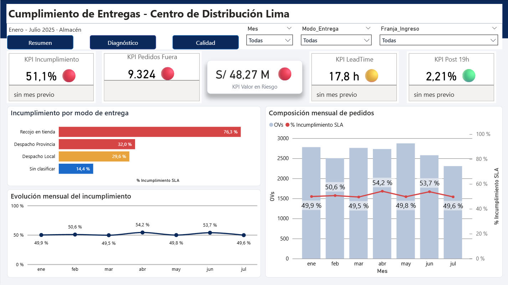
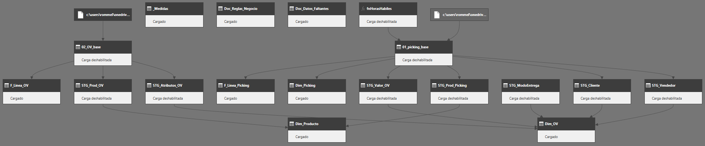

# Cumplimiento de plazos de entrega — Centro de Distribución

**Me pidieron medir cuántos pedidos entraban después de las 7 de la noche. Eran el 2,21 % del total — y los que mejor cumplían.** Este es el proyecto de Power BI que, en vez de entregar ese número, encontró las dos causas que sí explicaban que uno de cada dos pedidos llegara tarde.

`Power BI` · `Power Query (M)` · `DAX` · `Modelo dimensional en constelación`

Distribuidor mayorista de materiales eléctricos · Enero – Julio 2025 · 18.538 pedidos · 2 fuentes, 270.703 registros crudos



---

## El problema, y el pedido que estaba mal formulado

La gerencia de operaciones pidió un dato puntual: el porcentaje de órdenes de venta que ingresan después de las 19:00. La hipótesis implícita era que los pedidos tardíos congestionaban el día siguiente.

El problema real era otro: **el 51,1 % de los pedidos no llegaba dentro del plazo prometido al cliente** — 9.324 pedidos, con S/ 48,27 millones de facturación expuesta a reclamo. El indicador se mantiene entre 49,5 % y 54,2 % durante los siete meses, sin estacionalidad: es crónico y estructural.

La hora de ingreso era un síntoma que alguien asumió como causa. Antes de responder lo que me pidieron, verifiqué si era cierto.

## Cuatro hipótesis, con su criterio de refutación definido antes de medir

| # | Hipótesis | Qué la daría por falsa | Veredicto |
|---|---|---|---|
| H1 | La hora de ingreso explica el incumplimiento | Que las franjas horarias muestren tasas similares entre sí | ❌ **Refutada** |
| H2 | La carga diaria del almacén lo explica | Que no haya relación creciente entre volumen y tiempo | ❌ **Refutada** |
| H3 | La complejidad del pedido lo explica | Que el tiempo se mantenga plano al aumentar las líneas | ✅ Confirmada |
| H4 | La disponibilidad del producto lo explica | Que el tiempo sea similar con y sin stock | ✅ Confirmada |
| H5 | Algún plazo prometido no es alcanzable | Que la mediana de cada modalidad esté dentro de su plazo | ✅ Confirmada |

El criterio de refutación es lo que convierte una sospecha en hipótesis: define por adelantado qué resultado la daría por falsa. Sin él, cualquier gráfico confirma lo que uno ya creía.


### Lo que la evidencia descartó

**La hora de ingreso no explica nada.** Las seis franjas se mueven entre 41,7 % y 53,0 %: once puntos de rango contra un incumplimiento general del 51,1 %. La franja nocturna —la sospechosa— es la que **menos** incumple.

**La carga del almacén tampoco.** El almacén procesa entre 110 y 170 pickings diarios y el tiempo se mantiene entre 5 y 10 horas hábiles, muy por debajo de las 24 comprometidas. Más carga no produce más demora: no se satura. Este hallazgo descartó ampliar la dotación, que era la decisión más costosa sobre la mesa.

### Las dos causas reales

| Factor | Efecto |
|---|---|
| **Disponibilidad de stock** | Con el producto en almacén, el 49,33 % llega tarde. Si requiere traslado, 78,25 %. Si hay que comprarlo, **86,88 %**. El problema nace antes del almacén, en abastecimiento |
| **Complejidad del picking** | Hasta 15 líneas se prepara en 6-9 horas, dentro del plazo. A partir de 16 líneas el tiempo salta a **31 horas** y rompe las 24 comprometidas |

### Y una falla de diseño, no de operación

El recojo en tienda promete **2 horas hábiles** sobre un proceso cuya mediana real es **4,2 horas**. Su 76,3 % de incumplimiento no mide una falla del equipo: mide una promesa que el proceso nunca pudo cumplir. Es la corrección más barata del proyecto —un parámetro, no un proceso— y la de mayor impacto, porque es la modalidad con la peor tasa.

---

## Los datos

| | Fuente 1 | Fuente 2 |
|---|---|---|
| **Qué es** | Listado de documentos de picking | Listado de órdenes de venta |
| **Sistema** | ERP — módulo de almacén | ERP — módulo comercial |
| **Registros crudos** | 108.988 × 30 columnas | 161.715 × 32 columnas |
| **Grano** | Una fila por línea de picking | Una fila por línea de orden |
| **Qué aporta** | Fechas y horas de todo el ciclo, cantidades, modalidad de entrega | Acción de abastecimiento, stock por almacén, precio, atributos del producto |

**Universo analizado:** solo el almacén del CD, solo órdenes de venta, solo 2025. Resultado: 70.493 filas de picking · 21.761 pickings · 18.538 pedidos · **98,52 % con tiempo medible**.

Los archivos de origen no están en este repositorio: son datos de una empresa real. Su estructura está documentada para que el proceso sea auditable sin exponerlos.

---

## El modelo


Es una **constelación de hechos**, no una estrella ni un copo de nieve: dos tablas de hechos (`F_Linea_OV` y `F_Linea_Picking`) comparten las mismas dimensiones conformadas.

**Por qué esa forma y no otra.** El indicador vive a nivel de pedido, pero los dos procesos que lo producen tienen granos distintos: la línea comercial y la línea de picking. Analizarlos juntos sin duplicar conteos exige dos tablas de hechos y dimensiones compartidas. Las dimensiones que al principio colgaban de otra dimensión se **aplanaron por merge** — el modelo quedó limpio sin perder un solo atributo.

| Decisión | Por qué |
|---|---|
| `Dim_OV` es **dimensión**, no tabla de hechos | El KPI vive a nivel de pedido. Así cada medida es un `COUNTROWS` en vez de un `DISTINCTCOUNT` sobre detalle, con riesgo permanente de duplicar |
| Un solo calendario con **relaciones inactivas** | Sirve a tres fechas distintas vía `USERELATIONSHIP`, en vez de tres calendarios que triplicarían los segmentadores |
| Las tablas de hechos llevan **solo llaves y métricas** | Todo lo que sirve para filtrar vive en una dimensión |
| Los plazos en una **tabla de parámetros** | Recalibrar un SLA es editar una celda, no catorce fórmulas — que es justo la recomendación del informe |
| Las derivadas son **referencias**, no duplicados | Un arreglo en la base se propaga a las nueve consultas que dependen de ella |



---

## Las cuatro trampas del dato

Lo que separa un ETL que corre de uno que dice la verdad. Las cuatro se detectaron con números de control, no leyendo columnas.

### 1 · Un importe que no se puede sumar

`DOC_VENTA_SOL` venía repetido en cada línea del detalle: es un dato de cabecera alojado en el detalle. Sumarlo directo daba **S/ 116,75 M contra S/ 82,23 M reales — un 42 % de inflación.**

```m
// Dos agrupaciones encadenadas: la primera colapsa la repetición,
// la segunda suma los valores ya únicos.
#"Quitar repeticion por OV y SKU" =
    Table.Group(Origen, {"Nro_Doc", "Cod_Sap"},
        {{"Valor_Linea", each List.Max([Doc_Venta_Sol]), type nullable number}}),
#"Sumar valor por OV" =
    Table.Group(#"Quitar repeticion por OV y SKU", {"Nro_Doc"},
        {{"Valor_OV", each List.Sum([Valor_Linea]), type nullable number}})
```

### 2 · Un vacío que no era un vacío

El 68,9 % de los pedidos de recojo no tiene guía de remisión. No era un dato faltante: **es cómo cierra ese proceso** — un recojo se cierra con la factura. Entenderlo subió la cobertura medible del 66,9 % al **98,52 %**.

```m
FechaHora_Fin =
    if [Modo_Entrega] = "Recojo en tienda" then [FechaHora_FA]
    else if [FechaHora_GR] <> null         then [FechaHora_GR]
    else [FechaHora_FA]
```

### 3 · Horas calendario que mentían

La política de la empresa está en **horas hábiles**. Un pedido emitido un viernes a las 18:00 no lleva 60 horas de retraso el lunes: lleva las que el almacén estuvo abierto. La función está parametrizada con cuatro horarios, así que sirve a las dos modalidades con ventanas distintas.

```m
(Inicio as nullable datetime, Fin as nullable datetime,
 AbreLV as number, CierraLV as number,
 AbreSab as number, CierraSab as number) as nullable number =>
    // Lista los días del intervalo, calcula la intersección entre la ventana
    // operativa de cada día y el intervalo real, y suma.
    // Devuelve null si falta una fecha: un null se clasifica como "sin medición";
    // un cero se contaría como cumplimiento perfecto.
```

### 4 · Una tabla de hechos que perdió 5.683 filas en silencio

La primera versión de `F_Linea_Picking` usó **Agrupar por** en lugar de **Elegir columnas**: 64.810 filas en vez de 70.493, y 2.951.168 unidades menos. **No dio ningún error.** Se detectó comparando el conteo contra la base.

> **La regla que salió de ahí:** dimensión → Agrupar por. Hechos → Elegir columnas. En una tabla de hechos el conteo de filas **nunca** cambia al reducir columnas. Si bajó, se usó la herramienta equivocada.

---

## Las medidas que resuelven un problema

Cuatro de las 45, las que existen porque sin ellas el número habría estado mal. El resto son variantes de formato.

**Un juicio con tres valores, no dos.** Un pedido sin fecha de cierre no es un pedido cumplido:

```dax
Cumple_SLA =
SWITCH( TRUE(),
    ISBLANK( Dim_OV[LeadTime_Hab] ),            "Sin medicion",
    Dim_OV[LeadTime_Hab] <= Dim_OV[SLA_Horas],  "Cumple",
                                                "Incumple" )
```

**El denominador correcto** — los medibles, nunca el total:

```dax
% Incumplimiento SLA = DIVIDE( [OVs Fuera de SLA], [OVs Medibles] )
```

**`REMOVEFILTERS` en numerador y denominador.** La primera versión de esta medida daba 1,63 % porque `CALCULATE` sobrescribía el segmentador en una parte y no en la otra — un conflicto de contexto de filtro que **no lanza ningún error**:

```dax
% OVs Post 19h =
VAR _Nocturnas = CALCULATE( [OVs],
                    REMOVEFILTERS( Dim_OV[Franja_Ingreso] ),
                    Dim_OV[Franja_Ingreso] = "6. Nocturno (>19:00)" )
VAR _Total     = CALCULATE( [OVs], REMOVEFILTERS( Dim_OV[Franja_Ingreso] ) )
RETURN DIVIDE( _Nocturnas, _Total )
```

**`CROSSFILTER` para cruzar la constelación.** El filtro nace en una tabla de hechos y tiene que llegar a una dimensión. Sin esto las tres categorías mostraban el mismo valor — el otro error que no avisa:

```dax
% Incumplimiento por Accion =
CALCULATE( [% Incumplimiento SLA],
    CROSSFILTER( Dim_OV[Nro_Doc], F_Linea_OV[Nro_Doc], BOTH ) )
```

---

## El tablero

Tres páginas, cada una respondiendo **una** pregunta:

| Página | Pregunta | Qué tiene |
|---|---|---|
| **Resumen** | ¿Qué está pasando y cuánto cuesta? | 5 KPI con semáforo, evolución mensual, incumplimiento por modalidad |
| **Diagnóstico** | ¿Por qué pasa? | Un panel por hipótesis, cada gráfico con su veredicto escrito debajo y la línea de referencia del plazo |
| **Calidad** | ¿Cuánto de esto puedo creer? | Cobertura, cada regla con su fuente, los datos que faltan y **cómo NO usar este informe** |

Más dos páginas de información sobre herramientas con navegación entre páginas y filtrado cruzado.


**La página de Calidad es la que casi nadie hace.** Declara qué regla viene del procedimiento oficial, cuál la supuso el analista y cuál no existe — incluyendo que **la empresa no tiene meta formal de cumplimiento**, así que decir que 51,1 % es «malo» es criterio mío, no norma.

---

## Qué demuestra este proyecto

| Capacidad | Dónde se ve |
|---|---|
| **Reformular el pedido del stakeholder** | El pedido era la hora de ingreso; el problema era el quiebre de stock |
| **Hipótesis falsables** | Criterio de refutación definido antes de medir, y dos hipótesis refutadas |
| **ETL con lenguaje M** | 18 consultas por capas, funciones parametrizadas, arquitectura de referencias |
| **Detectar errores silenciosos** | Campo no aditivo, filas perdidas por la herramienta equivocada, contexto de filtro |
| **Modelado dimensional** | Constelación de hechos, dimensiones conformadas, outriggers aplanados, relaciones inactivas |
| **DAX no trivial** | `USERELATIONSHIP`, `CROSSFILTER`, `REMOVEFILTERS`, guardas de período |
| **Diseño orientado a decisión** | Cada gráfico con su veredicto; un bloque de qué **no** hacer |
| **Honestidad analítica** | Página de calidad, proxies declarados, hipótesis descartadas publicadas |

---

## Limitaciones

- **El segmento comercial del cliente no existe en la fuente.** Lo usado es una aproximación por comportamiento de compra, declarada como proxy. No sirve para decisiones comerciales por cliente.
- **No hay meta formal de cumplimiento.** Los umbrales del semáforo (15 % / 30 %) los definí yo. El juicio rojo/ámbar/verde es orientativo, no normativo.
- **291 pedidos de 2024 están excluidos.** Como ese backlog ya estaba fuera de plazo, el incumplimiento real es algo mayor al 51,1 % reportado.
- **No se puede separar la demora de almacén de la de facturación**: falta la hora de liberación del picking. Es el primer dato que pediría para cerrar el análisis.
- **El costo real del incumplimiento no se pudo cuantificar.** Los S/ 48,27 M son facturación *expuesta*, no una pérdida: calcular la pérdida exige datos de penalidades y recompra que la empresa no registra.

---

## Qué hay en este repositorio

| Ruta | Contenido |
|---|---|
| [`codigo/etl-powerquery.pq`](codigo/etl-powerquery.pq) | Las 18 consultas en lenguaje M, en orden de dependencia |
| [`codigo/medidas-clave.dax`](codigo/medidas-clave.dax) | Las medidas que resuelven un problema concreto, con su justificación |
| [`img/`](img/) | Modelo relacional, árbol de dependencias y las tres páginas del tablero |

El `.pbix` no está publicado: es un binario que contiene los datos de origen embebidos. El código exportado permite auditar y reproducir cada transformación.

---

## Autor

**Rommel Aarón Reynaga Alvarado** — Analista de datos con formación en ingeniería industrial
[GitHub](https://github.com/Rommel-data) · [LinkedIn](https://www.linkedin.com/in/rommel-reynaga)

El modelado dimensional y el ETL se trabajaron en conjunto con un colega senior en Power BI. La definición del problema, las hipótesis, las medidas, el diseño del tablero y el análisis son propios.
