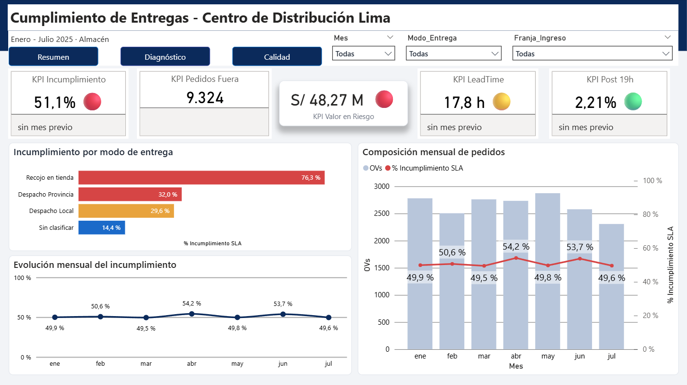
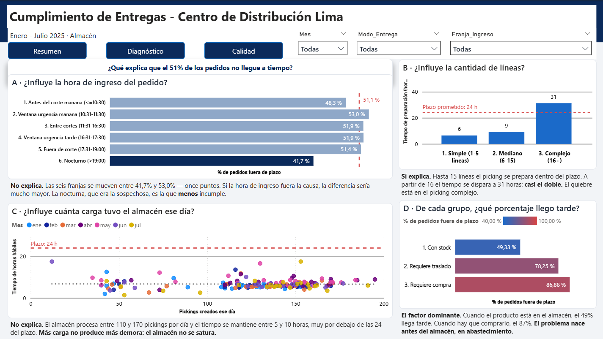
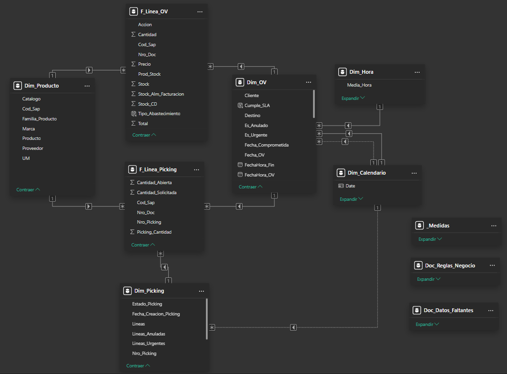
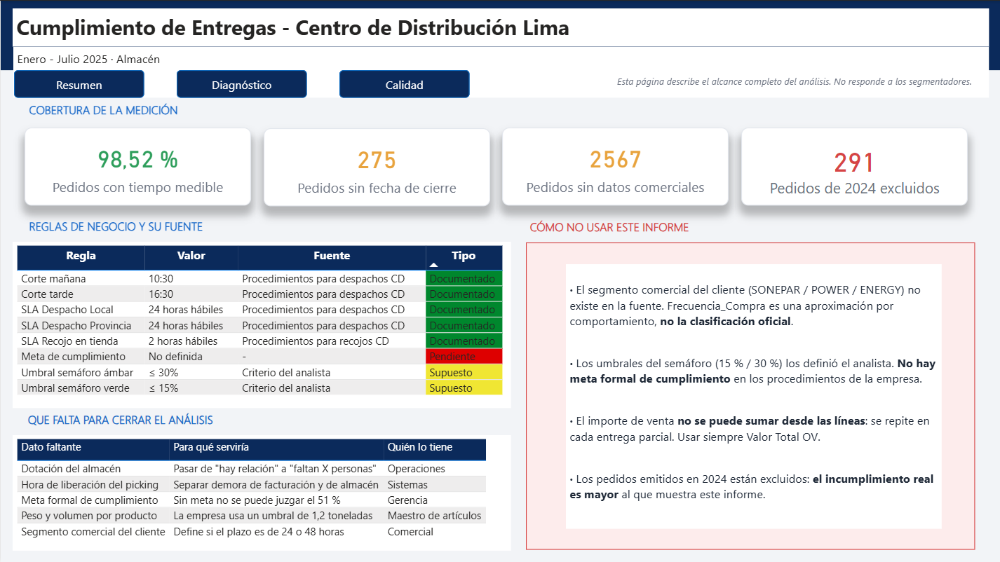

# 📦 Análisis de Cumplimiento de Entregas en un Centro de Distribución — Power BI, ETL y Modelo Dimensional

**Me pidieron medir cuántos pedidos entraban después de las 7 de la noche. Eran el 2,21 % del total — y los que mejor cumplían.** Este es el proyecto de Power BI que, en vez de entregar ese número, encontró las dos causas que sí explicaban que uno de cada dos pedidos llegara tarde.

`Power BI` · `Power Query (M)` · `DAX` · `Modelo dimensional en constelación`

Distribuidor mayorista de materiales eléctricos · Enero – Julio 2025 · **18.538 pedidos** · 2 fuentes del ERP · 270.703 registros crudos



## 📩 Conéctate conmigo

¿Tienes un proceso donde nadie sabe por qué se incumple, datos repartidos entre el ERP y Excel, o un tablero que muestra mucho y no termina en ninguna decisión? Eso es lo que resuelvo: entender el negocio, modelar el dato y dejar un indicador accionable.

<p align="center">
  <a href="https://www.linkedin.com/in/rommel-aar%C3%B3n-reynaga-alvarado-470299222/">
    
  </a>
</p>

## 🗂️ Estructura del Proyecto

1. [🎯 El problema y las hipótesis](#-1-el-problema-y-las-hipótesis)
2. [🔧 Los datos: extracción y transformación](#-2-los-datos-extracción-y-transformación)
3. [🧩 El modelo dimensional](#-3-el-modelo-dimensional)
4. [📊 Las medidas y el tablero](#-4-las-medidas-y-el-tablero)
5. [⚠️ Alcance y limitaciones](#-5-alcance-y-limitaciones)

---

## 🎯 1. El problema y las hipótesis

La gerencia de operaciones pidió el porcentaje de órdenes que ingresan después de las 19:00, asumiendo que los pedidos tardíos congestionaban el día siguiente.

El problema real era otro: **el 51,1 % de los pedidos no llegaba dentro del plazo prometido** — 9.324 pedidos, S/ 48,27 M de facturación expuesta. El indicador se mantiene entre 49,5 % y 54,2 % durante los siete meses: crónico y estructural, sin estacionalidad.

Antes de responder lo que me pidieron, verifiqué si la hora de ingreso era realmente la causa.

### Cinco hipótesis, con su criterio de refutación definido antes de medir

| # | Hipótesis | Qué la daría por falsa | Veredicto |
|---|---|---|---|
| H1 | La hora de ingreso explica el incumplimiento | Que las franjas horarias muestren tasas similares | ❌ **Refutada** |
| H2 | La carga diaria del almacén lo explica | Que no haya relación creciente volumen → tiempo | ❌ **Refutada** |
| H3 | La complejidad del pedido lo explica | Que el tiempo se mantenga plano al subir las líneas | ✅ Confirmada |
| H4 | La disponibilidad del producto lo explica | Que el tiempo sea similar con y sin stock | ✅ Confirmada |
| H5 | Algún plazo prometido no es alcanzable | Que la mediana de cada modalidad entre en su plazo | ✅ Confirmada |



### Lo que descarté

**La hora de ingreso.** Las seis franjas se mueven entre 41,7 % y 53,0 %: once puntos de rango contra un 51,1 % general. La nocturna —la sospechosa— es la que **menos** incumple.

**La carga del almacén.** Procesa entre 110 y 170 pickings diarios con tiempos de 5 a 10 horas hábiles, muy por debajo de las 24 comprometidas. Más carga no produce más demora. Esto descartó ampliar la dotación, la decisión más costosa sobre la mesa.

### Lo que confirmé

| Factor | Efecto |
|---|---|
| **Disponibilidad de stock** | Con producto en almacén, **49,33 %** llega tarde. Con traslado, **78,25 %**. Con compra, **86,88 %**. El problema nace antes del almacén, en abastecimiento |
| **Complejidad del picking** | Hasta 15 líneas: 6-9 h, dentro del plazo. Desde 16 líneas: **31 h**, rompe las 24 comprometidas |
| **El plazo de recojo** | Promete **2 h hábiles** sobre un proceso de mediana **4,2 h**. Su 76,3 % no mide una falla del equipo: mide una promesa inalcanzable |

La tercera es la corrección más barata —un parámetro, no un proceso— y la de mayor impacto sobre el indicador global.

---

## 🔧 2. Los datos: extracción y transformación

### Las fuentes

Dos extractos del **ERP corporativo**, de módulos distintos:

| | Módulo de almacén | Módulo comercial |
|---|---|---|
| **Qué registra** | Documentos de picking | Órdenes de venta |
| **Volumen** | 108.988 × 30 | 161.715 × 32 |
| **Grano** | Línea de picking | Línea de orden |
| **Aporta** | Fechas y horas del ciclo, cantidades, modalidad de entrega | Acción de abastecimiento, stock por almacén, precio, atributos de producto |

**Universo:** almacén del CD · solo órdenes de venta · solo 2025 → 70.493 filas · 21.761 pickings · 18.538 pedidos · **98,52 % con tiempo medible**.

Los extractos no están publicados: son datos de una empresa real. El código en [`Scripts/`](Scripts/) permite auditar cada transformación sin exponerlos.

### Los siete controles de limpieza

Antes de transformar nada, pasé el conjunto por siete controles. Esta tabla resume qué encontró cada uno y qué hice.

| # | Control | Hallazgo | Acción |
|:--:|---|---|---|
| 1 | **Duplicados exactos** | 1.006 filas idénticas en el extracto de picking | Eliminadas con `Table.Distinct` — **después** de quitar el correlativo del export, que hacía única a cada fila |
| 2 | **Textos inconsistentes** | `Forma_Entrega` traía variantes del mismo valor: `Recjo-Tda`, `Des-Lima`, `Des-Prov`, mayúsculas y abreviaturas mezcladas | Normalizadas a 4 modos con `Text.StartsWith`, más una categoría `Sin clasificar` visible |
| 3 | **Valores nulos** | `Comentarios_Picking`, `Fecha_GR` y `Fa_Creacion` con nulos dispersos | Cada columna derivada lleva su `if … = null then null`. Nunca se rellena: un nulo propagado es información, un cero es una afirmación falsa |
| 4 | **Campo horario corrupto** | `PICKING_FECHA` con reloj de 12 h sin AM/PM — las horas solo iban de 1 a 12 | Se conserva únicamente la fecha. La hora se declara irrecuperable y no se usa en ningún cálculo |
| 5 | **Importe no aditivo** | `DOC_VENTA_SOL` repetido en cada línea del detalle | Reducido al grano de pedido antes de sumar *(detalle abajo)* |
| 6 | **Rango de fechas** | 291 pedidos emitidos en 2024 | **Excluidos del período.** Al ser backlog ya vencido, su exclusión hace que el incumplimiento reportado sea conservador |
| 7 | **Registros sin cierre** | 275 pedidos sin fecha de entrega registrada | **No se excluyen del universo:** se clasifican como «sin medición» y salen del denominador del indicador, pero siguen contando en el total |

> **Los controles 6 y 7 son exclusiones distintas y no deben confundirse.** El 6 saca registros del *período analizado*. El 7 los mantiene en el universo pero los deja fuera del *cálculo del indicador*, porque no tienen con qué medirse.

### La arquitectura del ETL

```
         fnHorasHabiles
                │
   ┌────────────┴────────────┐
01_picking_base        02_ov_base          ← leen el ERP · sin carga
   │                         │
   ├── 6 consultas STG ──────┤              ← preparan · sin carga
   │                         │
   ├── Dim_OV · Dim_Picking · Dim_Producto  ← Agrupar por
   └── F_Linea_Picking · F_Linea_OV         ← Elegir columnas
```

| Capa | Técnica | ¿Carga? |
|---|---|:--:|
| Función | Parametrizada, 4 argumentos | — |
| Base | Filtros · tipado con locale · deduplicación | ✖ |
| Staging | Agrupar por | ✖ |
| Dimensión | Agrupar por + merge | ✔ |
| Hechos | Elegir columnas | ✔ |
| Documentación | Enter Data | ✔ |

**18 consultas · 9 tablas en el modelo.** Todas las derivadas son *referencias* a la base: se arregla en un solo punto y se propaga a las nueve que dependen de ella.


### Las cuatro transformaciones que decidieron el resultado

Los controles de arriba limpian. Estas cuatro decisiones son las que hicieron que el número fuera correcto — y las cuatro salieron de comparar **conteos entre capas**, no de leer columnas.

#### 1 · Importe no aditivo — 42 % de inflación

`DOC_VENTA_SOL` es un dato de cabecera repetido en cada línea del detalle. Sumado directo daba **S/ 116,75 M** contra **S/ 82,23 M** reales. Lo resolví con dos agrupaciones encadenadas:

```fsharp
// La primera colapsa la repetición; la segunda suma los valores ya únicos.
#"Quitar repeticion por OV y SKU" =
    Table.Group(Origen, {"Nro_Doc", "Cod_Sap"},
        {{"Valor_Linea", each List.Max([Doc_Venta_Sol]), type nullable number}}),
#"Sumar valor por OV" =
    Table.Group(#"Quitar repeticion por OV y SKU", {"Nro_Doc"},
        {{"Valor_OV", each List.Sum([Valor_Linea]), type nullable number}})
```

#### 2 · Cobertura: de 66,9 % a 98,52 %

El 68,9 % de los recojos no tiene guía de remisión porque **ese proceso cierra con la factura**. Definí el cierre por modalidad:

```fsharp
FechaHora_Fin =
    if [Modo_Entrega] = "Recojo en tienda" then [FechaHora_FA]
    else if [FechaHora_GR] <> null         then [FechaHora_GR]
    else [FechaHora_FA]
```

#### 3 · Medición en horas hábiles

La política de la empresa se expresa en horas hábiles. Construí una función parametrizada con cuatro horarios, para servir a las dos modalidades con ventanas operativas distintas:

```fsharp
(Inicio as nullable datetime, Fin as nullable datetime,
 AbreLV as number, CierraLV as number,
 AbreSab as number, CierraSab as number) as nullable number =>
    // Lista los días del intervalo, intersecta la ventana operativa de cada uno
    // con el intervalo real y suma. Devuelve null si falta una fecha: un null
    // se clasifica como "sin medición"; un cero contaría como cumplimiento.
```

#### 4 · Integridad de la tabla de hechos

Al validar el conteo contra la base detecté una diferencia de **5.683 filas y 2.951.168 unidades** que no producía ningún error. El origen: `Agrupar por` donde correspondía `Elegir columnas`.

> **Regla aplicada en todo el modelo:** dimensión → `Agrupar por`. Hechos → `Elegir columnas`. En una tabla de hechos el conteo **nunca** cambia al reducir columnas.

---

## 🧩 3. El modelo dimensional



**Constelación de hechos:** dos tablas de hechos (`F_Linea_OV` y `F_Linea_Picking`) compartiendo dimensiones conformadas. No es estrella ni copo de nieve.

El indicador vive a nivel de pedido, pero los dos procesos que lo producen tienen granos distintos —línea comercial y línea de picking—. Analizarlos juntos sin duplicar conteos exige esa forma.

| Decisión | Efecto |
|---|---|
| `Dim_OV` como **dimensión**, no como hechos | Cada medida es un `COUNTROWS` en vez de un `DISTINCTCOUNT` sobre detalle |
| **Outriggers aplanados** por merge | Estrella limpia, sin perder un solo atributo |
| Un calendario con **relaciones inactivas** | Sirve a tres fechas vía `USERELATIONSHIP`, sin triplicar segmentadores |
| Hechos con **solo llaves y métricas** | Todo lo filtrable vive en una dimensión |
| SLA en **tabla de parámetros** | Recalibrar un plazo es editar una celda, no catorce fórmulas |

---

## 📊 4. Las medidas y el tablero

### 4.1 · Cuatro medidas, cuatro problemas resueltos

Cada una sigue la misma estructura: **qué quería lograr, qué lo impedía, cómo lo resolví.**

---

#### M1 · Clasificar el cumplimiento de cada pedido

| | |
|---|---|
| **Objetivo** | Saber si cada pedido llegó dentro del plazo que se le prometió al cliente |
| **Problema** | 275 pedidos no tienen fecha de cierre registrada. Con solo dos categorías —cumple / no cumple— habrían caído del lado de «cumple» |
| **Lógica** | Tres estados, no dos. Lo que no se puede medir se declara como tal en vez de asumirse |

```sql
Cumple_SLA =
SWITCH( TRUE(),
    ISBLANK( Dim_OV[LeadTime_Hab] ),            "Sin medicion",
    Dim_OV[LeadTime_Hab] <= Dim_OV[SLA_Horas],  "Cumple",
                                                "Incumple" )
```

---

#### M2 · El indicador principal

| | |
|---|---|
| **Objetivo** | El porcentaje de pedidos fuera de plazo — el KPI que encabeza el tablero |
| **Problema** | Si el denominador es el total, los 275 sin medición bajan el porcentaje y el resultado sale mejor de lo real |
| **Lógica** | Dividir sobre los **medibles**, no sobre el total |

```sql
OVs Medibles     = CALCULATE( [OVs], Dim_OV[Cumple_SLA] <> "Sin medicion" )
OVs Fuera de SLA = CALCULATE( [OVs], Dim_OV[Cumple_SLA] =  "Incumple" )

% Incumplimiento SLA = DIVIDE( [OVs Fuera de SLA], [OVs Medibles] )
```

---

#### M3 · Responder la pregunta original de gerencia

| | |
|---|---|
| **Objetivo** | Qué porcentaje del total ingresa después de las 19:00 |
| **Problema** | La primera versión daba **1,63 %** y el número cambiaba de forma absurda al mover el segmentador de franja horaria. `CALCULATE` reescribía el filtro en el numerador pero no en el denominador — y eso **no lanza ningún error** |
| **Lógica** | Quitar el filtro de franja en **las dos partes** de la división, para que el denominador sea siempre el total |

```sql
% OVs Post 19h =
VAR _Nocturnas = CALCULATE( [OVs],
                    REMOVEFILTERS( Dim_OV[Franja_Ingreso] ),
                    Dim_OV[Franja_Ingreso] = "6. Nocturno (>19:00)" )
VAR _Total     = CALCULATE( [OVs], REMOVEFILTERS( Dim_OV[Franja_Ingreso] ) )
RETURN DIVIDE( _Nocturnas, _Total )
```

Resultado corregido: **2,21 %**, y la franja con **menor** incumplimiento de las seis.

---

#### M4 · Cruzar abastecimiento con cumplimiento

| | |
|---|---|
| **Objetivo** | Ver el incumplimiento según si el producto estaba en stock, requería traslado o requería compra |
| **Problema** | La acción de abastecimiento vive en una **tabla de hechos** y el cumplimiento en una **dimensión**. El filtro no viaja en esa dirección: las tres categorías mostraban el mismo valor |
| **Lógica** | Abrir la relación en ambos sentidos, pero **solo dentro de este cálculo** — nunca como propiedad del modelo |

```sql
% Incumplimiento por Accion =
CALCULATE( [% Incumplimiento SLA],
    CROSSFILTER( Dim_OV[Nro_Doc], F_Linea_OV[Nro_Doc], BOTH ) )
```

Esta medida produjo el hallazgo dominante del proyecto: **49,33 % con stock contra 86,88 % si hay que comprar.**

---

### 4.2 · Las funciones DAX del modelo

| Función | Para qué la usé |
|---|---|
| `VAR` / `RETURN` | Evalúa una sola vez antes del `RETURN`: una medida reusa el valor sin recalcularlo |
| `CALCULATE` | La única que modifica el contexto de filtro |
| `SWITCH( TRUE(), … )` | Condiciones en cascada; se detiene en la primera verdadera |
| `DATEADD` | Desplaza el contexto de tiempo para la comparativa mensual |
| `USERELATIONSHIP` | Activa una relación inactiva dentro de un cálculo |
| `CROSSFILTER` | Propaga el filtro entre las dos tablas de hechos |
| `REMOVEFILTERS` | Ignora un segmentador cuando la medida responde sobre el total |

### 4.3 · La comparativa contra el mes anterior

Cada tarjeta del tablero muestra, debajo del valor, cuánto cambió respecto al mes previo. Eso **no es una medida: son cuatro encadenadas**, y cada nivel llama al anterior.

| Nivel | Medida | Qué hace | ¿Se ve en el tablero? |
|:--:|---|---|:--:|
| **1** | `% Incumplimiento SLA` | El número base del mes actual | Sí, en la tarjeta |
| **2** | `% Incumplimiento Mes Anterior` | El mismo número, un mes atrás | No |
| **3** | `Var Incumplimiento MoM` | La resta entre ambos | No |
| **4** | `Etiqueta Var Incumplimiento` | El texto con flecha que lee el usuario | Sí, bajo la tarjeta |

**Nivel 1** ya está arriba *(M2)*. Los otros tres:

```sql
-- NIVEL 2 · DATEADD no "va a buscar" el mes pasado: desplaza el contexto de
-- filtro un mes hacia atras y vuelve a evaluar la MISMA medida ahi.
% Incumplimiento Mes Anterior =
CALCULATE( [% Incumplimiento SLA], DATEADD( Dim_Calendario[Date], -1, MONTH ) )


-- NIVEL 3 · La resta, con una guarda.
-- Como DATEADD desplaza el rango COMPLETO, con los siete meses seleccionados
-- compararia "ene-jul" contra "dic-jun" y la resta daria casi cero. La guarda
-- exige que haya exactamente un mes activo; si no, no responde.
Var Incumplimiento MoM =
VAR _Meses  = DISTINCTCOUNT( Dim_Calendario[Anio_Mes] )
VAR _Actual = [% Incumplimiento SLA]
VAR _Previo = [% Incumplimiento Mes Anterior]
RETURN
    IF( _Meses <> 1 || ISBLANK( _Previo ) || ISBLANK( _Actual ),
        BLANK(),
        _Actual - _Previo )


-- NIVEL 4 · La lectura: flecha, signo y unidad.
Etiqueta Var Incumplimiento =
VAR _Var = [Var Incumplimiento MoM]
VAR _Flecha =
    SWITCH( TRUE(),
        ISBLANK( _Var ),  "",
        _Var >  0.005,    "▲",
        _Var < -0.005,    "▼",
                          "=" )
RETURN
    IF( ISBLANK( _Var ), "sin mes previo",
        _Flecha & " " & FORMAT( ABS( _Var ) * 100, "0.00" ) & " pp vs. mes anterior" )
```

**Por qué el `0.005` del nivel 4.** Si el indicador pasa de 51,10 % a 51,12 %, técnicamente subió — pero dos centésimas no son un cambio, son ruido. Ese número es el mínimo que hace falta para que la flecha aparezca: **medio punto porcentual**. Por debajo de eso, la tarjeta muestra `=`.

**Y por qué cambia según la medida.** El umbral se escribe en la misma unidad que la medida:

| Medida | Unidad | Umbral | Significa |
|---|---|---|---|
| `% Incumplimiento` | Porcentaje *(0,511)* | `0.005` | Medio punto porcentual |
| `LeadTime Mediano` | Horas *(17,8)* | `0.2` | Doce minutos |

Copiar el `0.2` de la medida en horas a una medida en porcentaje sería exigir que cambie **20 puntos** para mostrar la flecha. Nunca se activaría — y no daría ningún error.

**Los semáforos separan el número del juicio.** La medida numérica alimenta ejes y formato condicional; esta, en texto, solo vive en la tarjeta:

```sql
KPI Incumplimiento =
VAR _Valor = [% Incumplimiento SLA]
VAR _Semaforo =
    SWITCH( TRUE(),
        _Valor <= 0.15, "🟢",
        _Valor <= 0.30, "🟡",
                        "🔴" )
RETURN FORMAT( _Valor, "0.0%" ) & "  " & _Semaforo
```

### 4.4 · Las 45 medidas en tres capas

| Capa | Función | Ejemplos |
|---|---|---|
| **Visible** | Aparece en tarjeta, eje o tooltip | `KPI Incumplimiento` · `% Incumplimiento por Accion` · `Pickings del Dia` |
| **Intermedia** | Sostiene a otra; nunca se muestra | `OVs Medibles` · `% Incumplimiento Mes Anterior` · `Var Incumplimiento MoM` |
| **Complementaria** | Disponible, sin uso hoy | `% Cumplimiento SLA` · `Horas de Exceso` |

> **Criterio aplicado:** una medida entra al tablero si cambia una decisión. Si solo agrega una lectura más, se queda en el modelo. `Horas de Exceso` —cuánto se excede el plazo cuando se incumple— es el ejemplo: correcta, documentada, y fuera del tablero porque el caso ya se resolvía con el porcentaje y la causa.

### 4.5 · El tablero

Tres páginas, una pregunta cada una, más dos páginas emergentes con navegación y filtrado cruzado.

| Página | Pregunta | Contenido |
|---|---|---|
| **Resumen** | ¿Qué pasa y cuánto cuesta? | 5 KPI con semáforo, evolución mensual, incumplimiento por modalidad |
| **Diagnóstico** | ¿Por qué pasa? | Un panel por hipótesis, cada gráfico con su veredicto y la línea del plazo |
| **Calidad** | ¿Cuánto puedo creer? | Cobertura, cada regla con su fuente, datos faltantes y **cómo NO usar el informe** |



La página de **Calidad** declara qué regla viene del procedimiento oficial, cuál definí yo y cuál no existe — incluida la ausencia de meta formal de cumplimiento.

---

## ⚠️ 5. Alcance y limitaciones

### Qué demuestra este proyecto

| Capacidad técnica | Evidencia en el repositorio |
|---|---|
| **Extracción y limpieza en M** | 18 consultas por capas, tipado con locale, deduplicación sobre llave real |
| **Funciones personalizadas** | `fnHorasHabiles` parametrizada con 4 argumentos |
| **Arquitectura de consultas** | Referencias en vez de duplicados; carga selectiva de 9 de 18 |
| **Modelado dimensional** | Constelación, dimensiones conformadas, outriggers aplanados, relaciones inactivas |
| **Control de integridad** | Números de control entre capas; detección del campo no aditivo y de las filas perdidas |
| **DAX avanzado** | `USERELATIONSHIP` · `CROSSFILTER` · `REMOVEFILTERS` · `VAR/RETURN` · guardas de período |
| **Diseño de tablero** | Jerarquía de tres páginas, tooltips, navegación, formato condicional por reglas |
| **Trazabilidad** | Reglas, supuestos y vacíos declarados dentro del propio modelo |

### Limitaciones del dato

- **Segmento comercial del cliente:** no existe en la fuente. Se usó una aproximación por frecuencia de compra, declarada como proxy.
- **Hora de liberación del picking:** no se registra. Impide separar la demora de almacén de la de facturación.
- **Peso y volumen por producto:** ausentes en el maestro. La complejidad se mide por número de líneas, no por carga física.
- **291 pedidos de 2024 excluidos** del período. Al ser backlog ya vencido, el incumplimiento real es algo mayor al reportado.
- **2.567 pedidos sin datos comerciales** completos: entran en el cálculo global, no admiten cortes por cliente o vendedor.

### Limitaciones del análisis

- **No hay meta formal de cumplimiento** en la empresa. Los umbrales 15 % / 30 % son criterio del analista.
- **Los S/ 48,27 M son facturación expuesta, no pérdida.** Cuantificar el costo real exige penalidades y recompra, que no se registran.

### Qué hay en este repositorio

| Ruta | Contenido |
|---|---|
| [`Scripts/etl-powerquery.pq`](Scripts/etl-powerquery.pq) | 18 consultas en lenguaje M, en orden de dependencia |
| [`Scripts/medidas-clave.dax`](Scripts/medidas-clave.dax) | Las medidas del modelo, agrupadas por lo que resuelven |
| [`Picture/`](Picture/) | Modelo relacional, árbol de dependencias y las tres páginas del tablero |
